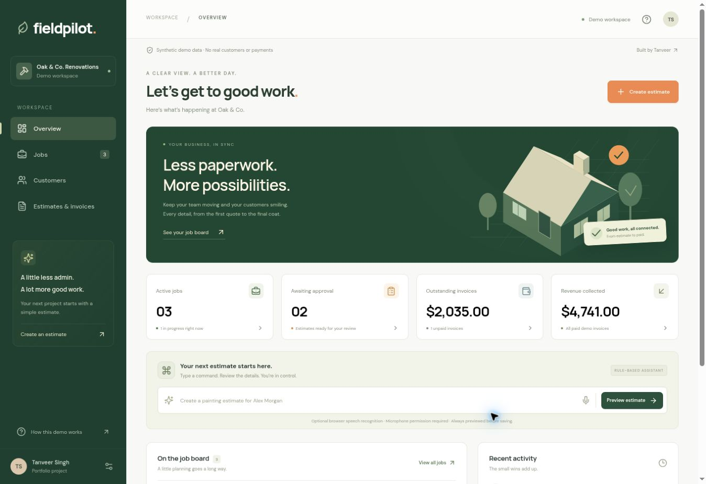

# FieldPilot

[**Open live demo**](https://fieldpilot-pied.vercel.app) · [Verification record](docs/verification.md) · [Source & architecture](docs/architecture.md)

A working renovation operations dashboard, built by [Tanveer Singh](https://singhtanveer.com). Create a customer, prepare an estimate, approve it into a scheduled job, move the job through completion, issue an invoice and record payment. Every overview metric comes from those records.

**This is a portfolio demo with synthetic Australian customer data and illustrative AUD prices. No emails, payment requests or real transactions are sent.**



## What works

- Responsive overview with active jobs, estimates awaiting approval, unpaid invoice totals, paid revenue and activity history.
- Customer creation and searchable customer directory.
- Editable estimates with line items, quantities, integer-cent unit prices and tax totals.
- Explicit approval creates exactly one scheduled job. Jobs move sequentially through scheduled, in progress and completed.
- Completed jobs generate one invoice, using the approved estimate's scope and prices. Invoices can be marked paid once.
- A deterministic command parser previews commands such as **“Create a painting estimate for Alex Morgan”**. The resulting scope and price are editable; confirmation is always required to save.
- Optional browser speech recognition uses the same parser and preview. It is feature detected and requires browser microphone permission. It is not an LLM integration; browser speech may involve the browser vendor's recognition service.
- Production state persists server side using a scoped Supabase/Postgres workspace adapter, with optimistic concurrency and explicit connection/save errors.

## Run locally

Requires **Node.js 22 or later** and npm.

```bash
npm ci
npm run dev
```

Open **http://127.0.0.1:5102**. Development uses a Vite middleware with isolated, in-memory workspaces. The page labels this mode explicitly. Restarting the development server clears those records. The production bundle never uses this local middleware.

```bash
npm test
npm run typecheck
npm run build
```

Tests use Node's test runner with the `tsx` import hook. Domain tests cover rounding, invalid data, immutable reducers, sequential job transitions, repeated estimate approval, duplicate invoices and command previews with no writes.

## Production deployment

Vercel detects the Vite frontend and `api/workspace.ts` Node function. Configure the environment variables listed in [.env.example](.env.example), apply the workspace schema supplied with the hosting setup, and deploy. `SUPABASE_PUBLISHABLE_KEY` is the public/publishable project key, not a service role key; row-level security gates access to a workspace capability.

The backend requires the `portfolio_demo_workspaces` table and `portfolio_demo_cas` SQL RPC. The API wrapper in `api/_lib` supplies token validation, request-size limits, no-store responses, compare-and-swap persistence and bounded retries. See [architecture](docs/architecture.md) for boundaries and deployment requirements.

## Architecture

| Layer                   | Responsibility                                                                      |
| ----------------------- | ----------------------------------------------------------------------------------- |
| `src/App.tsx`           | Navigation, server state, views, command and optional speech controls               |
| `src/components.tsx`    | Accessible native dialogs, customer form, estimate review and document details      |
| `src/domain.ts`         | Shared types, synthetic seed, totals, validated reducer and side-effect-free parser |
| `api/workspace.ts`      | FieldPilot configuration for the shared Node workspace adapter                      |
| `api/_lib/workspace.ts` | HTTP boundary, method/auth/body validation and consistent errors                    |
| `api/_lib/store.ts`     | Capability-scoped durable storage and optimistic concurrency                        |
| `vite.config.ts`        | React tooling and clearly labelled development-only API                             |
| `tests/domain.test.ts`  | Real domain behavior tests                                                          |

## Deliberate limits

This is a scoped MVP rather than a production business system. It has no account login, email delivery, file attachments, crew assignment editor, real payment processor, calendar integration or accounting integration. The workspace token is stored in this browser and grants access to that demo workspace. Do not put real customer data into it. Records are capped at 100 per category. Workspaces expire after seven days, and the client rotates its token after six days. Clearing browser storage also starts a fresh workspace.

All work is denominated in AUD. Tax defaults to 10% but is editable. The displayed tax and prices are demonstrations, not tax advice or trade quotations. No paid/free-plan conversion rates, generated testimonials or fabricated business metrics are shown.

[Design decisions](docs/design.md) · [Implementation plan](docs/plan.md) · [Portfolio](https://singhtanveer.com) · [GitHub](https://github.com/tanveerchana)
